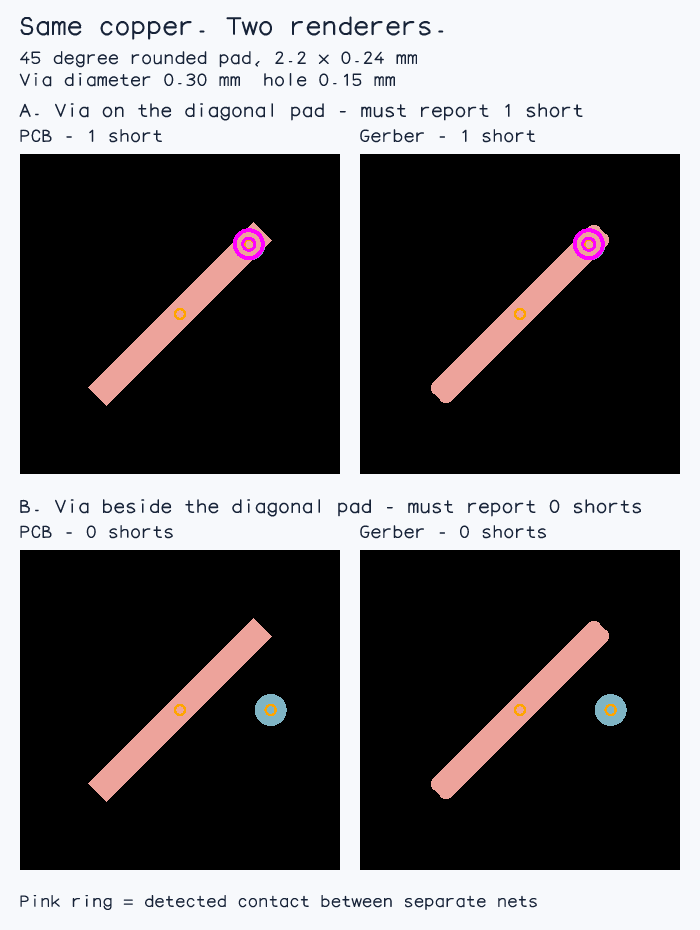

# Gerber aperture rotation changes short-check results

Run `bun test tests/repros/aperture-rotation`.

Both columns render the same Circuit JSON through the production checker. The
left uses PCB geometry; the right exports Gerber and rasterizes it. A pink ring
marks a detected contact between electrically independent copper objects.

The pad is 2.2 × 0.24 mm, with 0.06 mm corner radius and 45° counterclockwise
rotation. The via has 0.30 mm outer diameter and a 0.15 mm hole.

| Case       | Via center (mm) | Correct result | Before fix          | After fix |
| ---------- | --------------- | -------------- | ------------------- | --------- |
| A: contact | (0.65, 0.65)    | 1 short        | 0, a missed short   | 1         |
| B: clear   | (0.85, 0)       | 0 shorts       | 1, a false positive | 0         |

Case A lies along the pad's diagonal centerline. Case B is about 0.60 mm
from that centerline, exceeding the pad half-width plus via radius (0.27 mm).
The separation is deliberately much larger than a bitmap pixel.

The exported Gerber contains `%LR45*%`, but the original `gerber-parser` (used by
`gerber-to-svg` 4.2.8) ignored that command. It rendered a horizontal pad and
evaluated the wrong copper shape. The fixed renderer parses LR, carries rotation
through the plotter, and rotates the entire SVG aperture about its flash point.

The two expected failures from the repro PR are now ordinary passing tests, and
the snapshot shows the corrected output. The original Gerber and Circuit JSON
are preserved; the old 90° dimension-swapping workaround has been removed.
Additional pixel tests cover arbitrary angles, translated pads, rounded corners,
macro clear regions, and rotation reset.

This isolates the rotated-pad failure discussed in check-shorts #71 and #73;
it is not a reproduction of every short reported on the original user's board.
